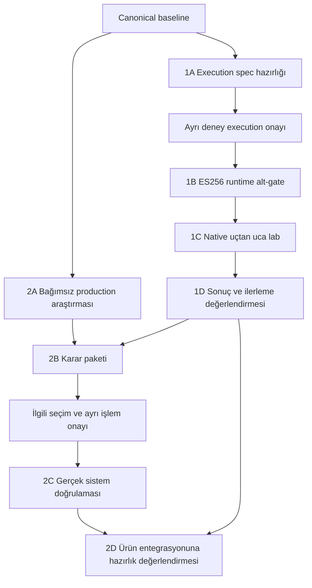

# Kloda — 1 ve 2. aşamalar: kapılı ürünleştirme yol haritası

## Statü ve izin sınırı

**Güncel yön [ADR0013](../decisions/0013-qr-based-local-lan-pairing.md) ve [QR implementation/evidence roadmap](qr-pairing-implementation-roadmap.md); QR native/bridge/UI implemented/build-tested, physical acceptance open.** ADR0012 P-256 identity korunur. Eski Matrix-key issuance/mTLS1A→1B→1C→1D planı, tabloları ve grafiği historical/superseded scope'tur. Matrix/SAS/binding/upstream/fork hiçbir current prerequisite/task değildir. ADR0009 bağımsız prerequisite-ready implementation yönü korunur; eski corpus recovery veya2A rerun gerekmez. [Güncel handoff kuyruğu](implementation-session-handoff.md#optimize-yürütme-kuyruğu) fiziksel pause ve bağımsız QR host adayını ayırır. Bu belge feasibility/ürün/native execution izni vermez.

Mevcut mobil/desktop/backend temelleri sıfırlanmaz. Sonraki 3. aşama mevcut uygulamalara gerçek authority/control entegrasyonunu, 4. aşama bunun üzerinden uçtan uca backup deneyimini tamamlamayı hedefler; ikisi de bu belgeyle yürütmeye açılmaz. İlgili platform kanıtı geliştirme boyunca toplanır: bütün release doğrulamalarını ürün kodundan önce bitmiş veya yalnız en sona bırakılmış varsayma.

Güncel başlangıç: [implementation session handoff](implementation-session-handoff.md). Bu roadmap ilgili authority/native entegrasyonunu prerequisite'siz hazır ilan etmez; ona bağımlı olmayan implementation'ı global olarak bloke etmez. Eksik kanıt teknik implementasyonu belirliyorsa ilgili dilimden önce hazırlanır; yalnız release/physical doğrulamasında gerekli kanıt ilgili noktada üretilir.

## Karar ve kanıt baseline'ı

| Kalıcı dayanak | Bu yol haritasına bağlayıcı sınır |
|---|---|
| [ADR0013](../decisions/0013-qr-based-local-lan-pairing.md) / [ADR0012](../decisions/0012-kloda-owned-p256-device-identity.md) | Offline backend-independent QR local trust; hardware-preferred Kloda P-256 identity, actual mutual TLS possession/PC SPKI equality, same-channel secret proof, PC approval/durable pins. Backend registry pin yaratmaz; trust file grant değildir |
| [ADR0004](../decisions/0004-certificate-bound-capability-and-authority-responsibilities.md) / [ADR0007](../decisions/0007-matrix-verification-and-device-continuity.md) | Matrix/single-key varsayımları historical. PC authority/time/deny/fence, exact leaf-DER-bound capability/reissue ve D03 persistence korunur. Initial QR LAN için PC Kloda key actual TLS SPKI'dır; remote binding ayrı |
| [Capability profile](../security/capability-profile.md) | Backend JWT yalnız user session; ayrı signed device/PC/scope/expiry capability authorization. Exact capability format ve key/channel association açık; server ES256 runtime+gerçek KMS gelene kadar provisional, device P-256 key ile aynı role/custody değil |
| [Historical feasibility planı](issuance-admission-feasibility-plan.md) | Eski same-Matrix-key native issuance→fresh mTLS→scoped list teklifinin spec/driver/matrisi korunur; execution olmadı, yeni P-256 acceptance olarak kullanılamaz |
| [Native/TLS evidence](../security/poc-native-verification-evidence.md) | Historical Rust17/native52/TLS25 her pair+host8 ve iki-method SDK byte-signer patch eski scope'tur. Counts/hash'ler korunur; P-256/hardware/SAS↔Kloda/session/remote proof'una aktarılmaz |
| [36 acceptance hedefi](../security/capability-acceptance.md) | **36 hedefin tamamı not-executed.** Eski SAS/TLS pass'leri bu matrise tam authority pass olarak taşınmaz |
| [Production/physical gates](../security/production-gates.md) | G01/02/03/05/06/09 ilk iki aşamanın doğrudan odağı; diğer gate'ler ve P01–P09 ayrı kanıt ister. Bir paket tamamlanması otomatik gate closure değildir |

Historical [preparation](issuance-admission-preparation.md) ve [recovery](../security/evidence-retention-and-recovery.md) eski kaynak sınırını kaydeder: SDK patch byte-verified kurtarıldı, original archive/verified final native corpus eksik, eski1A exact spec blocked. Bu historical provenance global irrecoverability iddiası veya yeni Kloda P-256 native dilimi için full corpus recovery gereği değildir. Private DB/key/epoch/state/credentials açılmaz/kopyalanmaz; eski source yerine fake fixture/API yazılmaz.

## Aşama 1 — izole issuance/admission feasibility

**Historical/superseded Matrix-key planı:** aşağıdaki1A–1D spec/driver/exit criteria yeni P-256 acceptance olarak yürütülemez; eski gate/statü bağlamıdır.

| Paket | İş | Önkoşul | Paralellik | Teslim | Çıkış kriteri | İzin sınırı | Gate |
|---|---|---|---|---|---|---|---|
| 1A | Public native kaynak ve mevcut toolchain/env envanterini salt okunur doğrula; actual code üzerinden exact lab claim/frame grammar, protected type, tek Rust backend, komutlar ve adversarial inputs'u sabitle | Baseline | 2A ile paralel; 1B'den önce | Ayrı, self-contained execution spec; public kaynak/pin ve prerequisite envanteri | Başka implementer tasarım kararı vermeden deney adımlarını çalıştırabilir ve sonuçları ayırabilir; eksik kaynak varsa spec hazır sayılmaz, exact blocker kaydedilir | Source okuma ve ayrı plan hazırlığı; build/install/deney yok. Bu roadmap hazırlığı 1A'yı gerçekleştirmiş sayılmaz | G01, G02, G03, G05, G07 (yalnız lab serialization), G09 |
| 1B | Yeni izole scratch'ta jose6.2.12→jsonwebtoken10.1.0 gerçek ES256 sign/verify/import ve strict validity rejection'ı çalıştır | 1A spec hazır + ayrı deney execution onayı + gerekli mevcut ortam | 2A ile paralel; 1C bunun sonucuna bağlı | Gerçek compact JWS wire, command/exit ve pozitif/negatif runtime sonuçları | Signature/claims tamper; yanlış alg/type/key/curve/kid/issuer/account/audience; missing claims ve exp/nbf sınırları gerçekten reddedilir; conservative lab time caller'dan alınmaz | Yalnız onaylanan scratch runtime; ürün dependency adoption, KMS veya servis kurulumu değil | G02 runtime alt-gate; G07/G08 yalnız lab kontrolü |
| 1C | Android–PC ve iOS–PC ayrı native issuance→fresh PC-session admission→gerçek scoped list akışını ve feasibility matrix adversarial/lifecycle varyantlarını çalıştır | 1B geçer + 1A native prerequisites + kapsamı içeren ayrı execution onayı | 2A ile paralel; platform sonuçları ayrı tutulur | Platform başına actual peer-DER/key/counter/session correlation, authorized exact file set ve refusal kayıtları | Authority actual ingress cert possession'dan issuance yapar; AS session close sonrası aynı Engine/key/epoch/SAS/**aynı DER** ile PC fresh full TLS açılır. Actual leaf DER token'a, leaf SPKI ayrı SAS key'e eşit; admission öncesi/yanlış root-op'ta filename yok. İki pair ve listed varyantlar gözlenmeden lab complete yok | Gerçek native lab; synthetic account/scope fixture gerçek Supabase enrollment/PC approval değil. Mock verified bool/DTO, ikinci identity key, private export/custom handshake yok; full upload/commit/path-race veya fiziksel/network proof değil | G01/G05/G09 alt-gate; G04/G08/G12 production sınırı açık |
| 1D | 1B/1C sonuçlarını36 target'a ve production gate'lerine scoped coverage ledger ile bağla | 1B/1C sonuç veya somut fail/blocked kayıtları | 2A sürdürülebilir; 2B/2D için ilgili bulgu girdisi | Per-platform supported/fail/blocked/not-executed, exercised subgate/partial/unexercised ledger ve ilerleme değerlendirmesi | Standalone verifier native lab complete diye sunulmaz; Android sonucu iOS'a taşınmaz; full36 pass/production-ready yok. Fail/blocked da raporlanabilir, ama positive feasibility exit değildir | Sonuç/review kaydı; başarısız bağımlılığı aşan protocol/backend/key fallback veya product code başlaması yok | G01, G02, G03, G05, G06, G09 kapsam değerlendirmesi |

Local software ES256 başarısı **KMS başarısı değildir**. Rust crate default leeway/nbf/exp equality davranışı trusted time yerine geçmez. Actual leaf pin yalnız root/trust-anchor pin ile değiştirilmez; token TLS application data'dır, transcript'inde signed sayılmaz. Same-key/new-DER lifecycle varyantında eski token ret ve authenticated reissue ayrı gözlenir; Engine cache production persistence değildir. Detaylı hedeflerin canonical kaydı mevcut feasibility/profile belgeleridir.

## Aşama 2 — production araştırması, karar ve gerçek sistem kanıtı

**Historical stage planı:** D01/D03/D02/D04 güncel scope'u ve dar P-256 prerequisite'i aşağıdaki current checkpoint'tedir; bu tablo upstream signer'ı current blocker yapmaz.

| Paket | İş | Önkoşul | Paralellik | Teslim | Çıkış kriteri | İzin sınırı | Gate |
|---|---|---|---|---|---|---|---|
| 2A | SDK exact-byte signer/upstream veya maintained packaging; hedef OS/native TLS/key-provider; issuer KMS/custody/hosting gereksinimleri; certificate persistence/renewal/epoch continuity için bağımsız kaynak araştırması | Baseline | 1A/1B/1C ile paralel; sonuçtan bağımsız araştırma fail/blocked durumunda da tamamlanabilir | Alan başına doğrulanmış primary source/version, eksik bilgi, gerekli karar ve smoke/prerequisite listesi | Source support, historical runtime ve gereken yeni runtime/physical proof ayrıdır; bilinmeyenler açık. Karar sahibi Ayhan; araştırma üretim seçimi yapmaz | Araştırma/karar hazırlığı ayrıca yürütülür; KMS/hosting markası seçme, account/key açma, cloud işlemi veya SDK fork adoption yok | G01, G02, G03, G06, G09 |
| 2B | İlgili 1D bulguları+2A ile provider/custody/hosting, SDK distribution ve certificate lifecycle karar paketini hazırla | 2A + ilgili 1D sonuçları; fail/blocked sonucu seçenekleri sınırlar, başarılı bağımlılık yerine geçmez | Kanıtı bağımsız alanların karar hazırlığı ayrılabilir; sonuç-bağımlı adoption öne çekilmez | Kanıtlı seçenek/öneri, izin kapsamı ve Ayhan'ın ayrı seçim/onay kaydı | Gereken seçimler onaylanmadan paket kapalı veya selected gösterilmez; kararsız alan decision-required. Bu roadmap provider, lifecycle API veya SDK release seçmez | Karar paketi hazırlamak decision approval değildir; remote provider/adoption ayrı G10/G11 işi, signer KMS seçimi onu seçmez | G01, G02, G03, G06, G09; G10/G11 bağımlılığı ayrı |
| 2C | Seçilmiş gerçek KMS Sign→jose/Rust verify; message/digest ve DER/raw R+S encoding; seçilmiş SDK/platform/certificate lifecycle smoke'larını çalıştır | İlgili 2B seçimi + ayrı cloud/device/deney işlem izni + her deneye exact execution spec/erişim | Bağımsız onaylı smoke'lar ayrılabilir; prerequisite olmadan hiçbirinin yerine local/simulator sonuç konmaz | Alan/platform başına gerçek command/exit, public correlation/encoding/import/rotation-revoke sonuçları ve açık physical kapsam | Actual KMS ve iki runtime interoperability gerçekten gözlenir; seçilmiş lifecycle/platform sınırı kanıtlanır. Eksik platform/physical kanıtı açık; software key veya simulator KMS/physical değildir | Yalnız ayrıca onaylanan gerçek sistem deneyleri; endpoint private key KMS'e verilmez, hizmet/credential/key otomatik oluşturulmaz | G01, G02, G03, G06, G09 scoped proof; P01–P09 ilgili kapsam açık |
| 2D | 1D+ilgili 2C ile 3. aşama hazırlığını değerlendir; kanıt/kalan boşluk/entegrasyonu bloke eden prerequisite/release öncesi kapsam ayrımı yaz | 1D + ilgili 2C sonuçları; eksikler değerlendirmede not-ready olur | Tek kapanış değerlendirmesi; alt sonuçlar per-platform kalır | G01/02/03/05/06/09 için kaynaklandırılmış readiness ledger ve 3. aşama planlamasına girdi | Gerekli adoption/seçim/deney kanıtı yoksa ilgili production entegrasyon işi ready değildir. ES256 runtime+actual KMS+ayrı karar kaydı olmadan provisional kalkmaz. Bu ayrım gate waiver değil | 3. aşama planlamasına dayanak; ürün code execution/release izni veya bütün gate'lerin kapanması değil | G01, G02, G03, G05, G06, G09; diğer gate'ler korunur |

## Bağımlılık grafiği ve yürütme kapıları

**Historical graph:** eski Matrix-key planına aittir; yeni P-256 execution grafiği veya full corpus recovery talimatı değil.

Grafik başarı varsaymaz: 1B fail/blocked ise 1C'nin pozitif akışı hazır değildir; 1D o engeli kaydeder. 1C fail/blocked ise 1D sonuç teslim edebilir fakat lab success çıkaramaz. 2B başarısız bağımlılığı gizleyemez; 2D eksik 2C'yi not-ready olarak değerlendirir, üretim izni yaratmaz. Bu özel engel kaydı geçişleri deney prerequisite'lerini atlama değildir.

**Birlikte planlama ≠ aynı anda bütün işleri yürütme.** İlk paralel hazırlık hattı 1A+2A'dır; sonraki onaylı 1B/1C boyunca 2A araştırması sürebilir. 2B'nin ilgili kararları 1D bulgularını, 2C gerçek işlemleri ayrıca seçim/erişim/deney onayını bekler. Stage1/2 deneyleri için mevcut roadmap veya eski research planı otomatik execution yetkisi değildir.

## Diğer gate'ler ve ürün entegrasyonu sınırı

- G04 gerçek account/device/PC approval provenance, G07 production schema, G08 trusted native time, G12 durable publication/filesystem fence ve G13 MFA/recovery gerçek authority entegrasyonuna ayrıca bağlanır. Lab serialization/controlled time/synthetic approval bunları kapatmaz.
- G10/G11 LAN/cellular/remote routing/provider/adoption için ayrıca kanıt ve karar ister. KMS hosting seçimi TURN/Tunnel veya production remote stack seçimi değildir.
- G14 Files/Photos/hash migration/restore, G15 native scheduling/release/UI ve G16 galeri/premium seçimi bu8 paketin tamamlanmasıyla bitmiş olmaz.
- P01–P09 fiziksel/native checklist ayrı kalır; simulator/emulator/host/source kanıtı physical pass sayılmaz. Gereken uyumluluk kanıtı ilgili entegrasyondan önce, kalan release kapsamı geliştirme sırasında toplanır; bu belge herhangi bir gate'i erteleme/waive yetkisi vermez.

## Yol haritası için belge walkthrough'ları

**Historical scenarios:** ADR0012'deki ayrı Kloda key yönü için yeni acceptance proof'u değildir.

Aşağıdaki satırlar gerçek runtime test sonuçları değil, karar/izin sınırının belge üstünde kontrol girdileridir.

| Senaryo | Beklenen roadmap kararı |
|---|---|
| S1 — Local ES256 ve iki native pair pass; KMS seçilmemiş | 1D yalnız sınırlı lab success kaydedebilir; ES256 provisional, G02/G06 açık. 2C KMS not-executed; product-ready yok |
| S2 — Android pass, iOS blocked | Per-platform fark korunur; bilateral lab complete false. 1D blocker kaydeder; 2A bağımsız araştırma devam edebilir |
| S3 — 2A tamam, 1D başarısız bağımlılık bildiriyor | 2B o başarısızlığı açık girdi yapar; olumlu adoption/production-ready sonucu veya ikinci endpoint key/custom handshake fallback yok |
| S4 — Simulator pass, fiziksel test yok | G01'in ilgili physical/release kapsamı ve P01–P09 kapanmaz; product-ready yok |
| S5 — Yalnız yol haritası hazırlığı onaylı | Yalnız bu doküman/analiz; scratch experiment, dependency install, service/cloud/product code yok. 36 target runtime statüsü değişmez |

## Bu teslimin doğrulama kapsamı

**Historical teslim/smoke/review:** aşağıdaki sonuçlar ADR0012 cutover'ını doğrulamaz; yeni check çalıştırılmadı.

Yeni dokümanın paket ID/8-kolon tabloları, dependency graph uçları ve relative links documentation smoke ile kontrol edilir; S1–S5 ayrı yazım-sonrası read-only review'da değerlendirilir. Bunlar deney veya production security proof değildir. Bu teslim eski PoC'leri çalıştırmaz, yeni KMS/SDK kararı vermez; tüm36 acceptance hedefinin not-executed kaydı korunur.

### Yazım-sonrası doğrulama sonucu

Documentation smoke **pass**: 8 unique paket/8 dolu kolon,11 graph node/12 dependency edge,0 dangling edge;7 relative link/0 missing target; S1–S5 mevcut. Canonical acceptance kaydı yeniden okundu:36 hedefin hepsi not-executed, statü değişmedi.

Ayrı read-only belge review geçişinde S1–S5 kararları paket önkoşulları ve izin kapılarıyla karşılaştırıldı: local signer KMS yerine geçmiyor; Android/iOS farkı korunuyor; fail/blocked bağımlılık hazır gösterilmiyor; simulator physical gate kapatmıyor; docs onayı deney izni değil. Maddi çelişki bulunmadı. Bu manual documentary review ve smoke, authority runtime veya production security proof değildir; build/test/SDK install/PoC/device/cloud işlemi yapılmadı.

## 1A/2A preparation checkpoint

[Preparation raporu](issuance-admission-preparation.md) eski erişilebilir1A toolchain/source/gap envanterini tamamladı; historical native execution spec kaynak eksikliği nedeniyle blocked kaldı. Bildirilen `docs/security/proof.tar.gz` hash/member doğrulaması yok; global irrecoverability iddiası yok.14×2 mapping ve36-ID ledger eski planned-only/not-executed kapsamdır; yeni P-256 source/protocol/acceptance yerine geçirilmez.

[Tamamlanmış2A kaynak araştırması](../security/production-readiness-research.md) historical source-limited bağlamdır; Matrix signer/SAS package/upstream/fork non-actionable archive'dır. Pinned jose remoteKMS callback sunmuyor: supported nonexport issuer integration D02/G02/G06'da açık, fakat initial QR trust backend/issuer beklemez. Research rerun/provider/stack/API seçimi yok; eski1B/1C/2C not-executed, ES256 provisional ve productionReady:false.

## 2B bağımsız karar hazırlığı checkpoint

[Karar paketi](production-decision-package.md) ve ADR0013: D01 Matrix/upstream/fork historical/non-actionable; D03-A native DER persistence retained, exact storage/API proof değil. D02 issuer/KMS ve D04 platform/time/hardware/background/release açık; backend authorization initial offline QR trust blocker'ı değildir. Android device-local signer scoped CLOSED/PASS aggregate platform gate değildir; tam2B/adoption kapanmadı. ADR0008 ve eski1A blocked/1B/1C not-executed historical scope'tur.

## ADR0009 bağımsız implementation checkpoint

Source-ID continuity prerequisite dilimi tamamlandıktan sonra, [handoff'taki ikinci dilim](implementation-session-handoff.md#ikinci-dilim--receiptpending-target-isolation) WebDAV receipt/pending hedef izolasyonunu uyguladı: transactional legacy veri korunması, per-run captured config ve hedefler arası skip/cleanup ayrımı. Yerel HTTPS gerçek byte-transfer smoke5 senaryoda pass, desktop lint/build ve12 test pass; ayrı review tamamlandı. Yerel journal schema değişikliği production G07 account/wire/schema adoption değildir.1A blocked,1B/1C/2C not-executed, ES256 provisional ve36 authority acceptance hedefi not-executed kalır. Eksik native corpus topluca rebuild edilmedi; UI/vault/native/physical/actual service gate'leri bu host fixture ile kapanmaz.

## Kesintisiz yürütme — kalan paketlerin checkpoint'i

**Güncel ADR0013 checkpoint — QR native/bridge/UI implemented/build-tested; physical acceptance open.**

[Frozen KLODA-QR-PAIR-V1 contract](../security/qr-pairing-v1-protocol.md) değişmedi; native mutual TLS/exporter API/ABI, state/approval/durable pins ve ACK recovery için mevcut implementation/build/synthetic evidence [QR roadmap'te](qr-pairing-implementation-roadmap.md) kayıtlıdır, yeniden implementation backlog'u değildir. Actual hardware LAN/adoption ve file authority açık kalır; Windows storage/certificate/VFS/continuity karar-blocker'ı ve physical pause için [güncel validation checkpoint](desktop-platform-validation-plan.md#güncel-yürütme-kapısı--fiziksel-doğrulama-duraklatıldı), bağımsız çalışma için [handoff kuyruğu](implementation-session-handoff.md#optimize-yürütme-kuyruğu) geçerlidir. Aşağıdaki Stage1/2 tabloları ve eski integration gereksinimi anlatımı historical bağlamdır; güncel source implemented/physical-open ayrımı roadmap'tedir. Eski [1D blocked-result](issuance-admission-preparation.md#1d-blocked-result-coverage-ledger) ve [2D not-ready ledger](issuance-admission-preparation.md#2d-not-ready-readiness-ledger) documentary historical teslimdir; pass aktarımı yok. Mevcut2A ve desktop smoke'ları yeniden yürütülmedi.

| Paket | Güncel teslim / yürütme durumu | Kalan somut girdi |
|---|---|---|
| 1A | **Historical/superseded**; eski spec blocked | Yeni P-256 exact ABI sayılmaz; old corpus rebuild/recovery current blocker değil |
| 1B | **Historical not-executed** | Eski lab JWS/type/backend spec yeni capability formatını seçmez; server ES256 runtime/KMS prerequisite ayrı açık |
| 1C | **Historical blocked / not-executed**, iki pair | Eski same-Matrix-key issuance/mTLS planı yeni P-256 acceptance olarak yürütülemez |
| 1D | Historical **blocked-result coverage teslimi** |36 canonical hedef not-executed/unexercised; historical pass/count yeni proof'a aktarılmaz |
| 2A | Tamamlanmış **source-limited historical araştırma** | Rerun gerekmez; yalnız yeni yönü belirleyen dar kaynak boşlukları hazırlanır |
| 2B | D01 auth retired; D03 retained; **partial / decision-required** | D02 nonexport issuer integration/custody/KMS; D04 exact platform/time/hardware/fallback/Linux/background |
| 2C | **not-executed / prerequisite-blocked** | Selected current source-backed provider/contract, per-smoke spec ve gerçek system erişimi; Matrix/upstream işi yok |
| 2D | **not-ready assessment**, positive exit değil | Current QR/native LAN/persistence/authority/time/lifecycle/system proof'ları ve P01–P09 açık |

**Yeni dar integration prerequisite required:** [frozen V1](../security/qr-pairing-v1-protocol.md) exact parser/HMAC/channel-binding/test vectors ve minimum native behavior sağlar; gerçek selected native exporter/API/ABI ve runtime proof açık. Gerçek P-256 mutual TLS1.3 possession, QR PC canonical SPKI hash = actual live TLS key; one-winner proof reservation, exact candidate PC approval, PC-local consume+pin durable transaction, phone PENDING-before-proof/pin-before-ACK ve same-key recovery uygulanmalıdır. Pre-consume restart eski invitation'ı restore etmez; post-consume pending recovery file authority değildir. Native callback ownership/encoding/errors/close/cancel/generation ve key/pin/cert/install continuity actual source-backed mapping gerektirir. Remote WebRTC/DTLS/signaling/Cloudflare TURN ayrı kalır; initial QR kararını tekrar açmaz.

Android hardware-backed P-256→TLS1.3 CertificateVerify **CLOSED/PASS (SM-S921B/API36)** yalnız device-local native TLS alt-gate'idir; actual Android↔PC LAN/final app/native bridge/iOS physical/desktop hardware/background ve full authority gates açık. Yeni QR acceptance matrisi future-only/not-executed; bütün36 authority hedefi not-executed.

Trust offline tamamlanabilir; account eligibility, operation step-up, PC scope, capability/time/deny/revoke/fence ve recovery sonrası grant için gereken online authorization ayrı kalır. Required identity/epoch/pin kaybında fresh QR re-trust + gerekli online authorization; hardware retention tek başına continuity değildir. Fake ABI/trusted-bool factory, eski driver'ın uydurma rewrite'ı veya bu docs tesliminden execution izni yok.

Bağımsız implementation ilerlemesi: [üçüncü dilim](implementation-session-handoff.md#üçüncü-implementation-dilimi--sha256-source-snapshot) desktop SHA256+private source staging'i uyguladı;17 test/lint/build ve6 host/HTTPS smoke pass. Source hash ve snapshot, authority/native issuer/admission/production filesystem fence proof'u değildir. Yukarıdaki1A/1B/1C/2B/2C prerequisite/decision durumları değişmedi.

[Dördüncü bağımsız dilim](implementation-session-handoff.md#dördüncü-implementation-dilimi--own-receipt-remote-byte-revalidation) own receipt'i skip öncesi authenticated remote whole-body SHA256 ile doğrular;26 test/lint/build ve5 real localhost HTTPS/error smoke pass. Bu issuer/native admission veya atomic remote publication proof'u değildir; yukarıdaki Stage1/2 native source/decision/system blocker'ları değişmedi.

[Beşinci bağımsız dilim](implementation-session-handoff.md#beşinci-implementation-dilimi--phase-bound-acknowledged-recovery) acknowledged pending recovery'yi uyguladı;34 test/lint/build ve14 gerçek host HTTPS/reopen/fault/path smoke pass. Unknown/unacknowledged work için silme/adoption yoktur; ambiguous recovery proof modeli karar bekler. Phase journal veya SHA eşitliği PC file authority/causal commit/physical durability değildir. Stage1/2 source, D02/D04, gerçek system/execution ve production gate durumları değişmedi.

[ADR0010](../decisions/0010-operation-bound-pc-commit-proof.md) ambiguous recovery için PC local operation-bound proof ve **authenticated PC result query** yönünü kabul etti; byte-presence shortcut veya portable signed receipt yok. [Yeni dar prerequisite inventory](implementation-session-handoff.md#pc-commit-proof--dar-prerequisite-sınırı) existing sender code'u reusable data primitive olarak ayırır; actual peer/native/authority/receiver-fence/result source ve exact query contract'ı olmadan dependent code başlamaz. Native corpus toplu rebuild veya Stage1/2 gerçek execution kapıları bu direction ile açılmadı.

