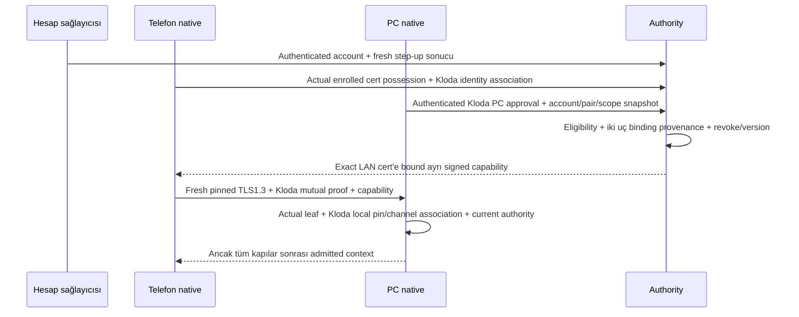

# Kloda — Capability ve admission profili

**Statü:** [ADR0013](../decisions/0013-qr-based-local-lan-pairing.md) backend-independent QR LAN ilk trust yönüdür; [ADR0012](../decisions/0012-kloda-owned-p256-device-identity.md) Kloda-owned P-256 identity ve hardware preference için korunur. Matrix/SAS current pairing path'inden çıkarılmıştır. ADR0004 authorization/exact-DER LAN capability yönü korunur; ES256 **provisional**, platform/TLS/DTLS/device-key **production gate** açık. [KLODA-QR-PAIR-V1](qr-pairing-v1-protocol.md) protocol bytes/lifecycle ve minimum native davranış frozen; actual API/ABI/adoption/integration unverified, implementation not executed. Capability private claim/type/wire/DB, KMS/hosting ve runtime trust/time/fence açık.

## Sonuç ve kanıt sınıfları

Kabul edilen yön: **ayrı signed capability + LAN'da fresh full pinned TLS1.3/SPKI ve Kloda P-256 mutual device proof**; server ES256 runtime ve KMS feasibility gelene kadar provisional, device key'inden ayrı custody/roldür. Initial QR LAN'da PC fingerprint'i actual live TLS'te kullanılan Kloda P-256 canonical SPKI SHA256 ile eşit olmalıdır; actual mutual CertificateVerify doğrulanır, one-time secret HMAC aynı channel/transcript'e bağlanır. Provisional phone possession durable trust değildir. PC explicit approval, local atomic consume+pin, phone PENDING-before-proof/durable pin/matching ACK/recovery sözleşmesi tek normative [frozen protocol](qr-pairing-v1-protocol.md) içindedir. Bu trust backend/login/internet olmadan tamamlanabilir; account enrollment, same-account file eligibility, step-up, scope approval, capability veya file access yaratmaz. File capability actual phone full leaf DER'e bağlanır; QR SPKI hash'i substitute değildir. Remote WebRTC/DTLS + signed signaling/fingerprint + mutual proof, direct P2P/Cloudflare TURN yönü ayrıdır.

- **accepted-policy:** ADR0003/0004/0012/0013; mevcut approved aynı-scope verified-LAN file authority için `<24h`, local revoke/öğrenilmiş deny ve durable publication fence.
- **historical observed-evidence:** eski Matrix-key patched-SDK native deneyinde host8, TLS25+25, verification26+26. [Native kanıt kaydı](poc-native-verification-evidence.md); QR/P-256/hardware/session/remote proof değildir, suite yeniden çalıştırılmadı.
- **Tarihsel public inspection:** Node v22.23.1 iki historical happy-path public cert/key/TLS kaydı, exit0;88 assertion shape kontrollerini de içerir,88 authority testi değildir. [Exact evidence](evidence/certificate-binding-inspection.json), [exact stdout](evidence/certificate-binding-stdout.json), [kaynak/limit özeti](evidence/capability-research-summary.json). Inspector kaldırılmıştır; bu aktarımda yeni crypto smoke yok.
- **unverified / production gate:** issuance/admission, native peer-DER/session bağı, gerçek enrollment/approval provenance, trusted time, scope/commit, issuer custody. JWT signing/verifying, revoke ve file enforcement runtime'ı yürütülmedi. Aşağıdaki semantik/enforcement tabloları hedef sözleşmedir, implemented API değildir.

Eski UTF-8-only Matrix signer/yama/upstream/fork/SDK işleri historical ve current pairing için non-actionable'dır; başka adla prerequisite yapılmaz. QR protocol/minimum native davranış [frozen](qr-pairing-v1-protocol.md); required current gate selected native P-256 provider/channel lifecycle, actual API/ABI/adoption/integration ve runtime implementation kanıtıdır. Ürün API `AppModule` boş; incelenen API manifesti JOSE içermez. Desktop/mobile WebDAV credentials ve journal ayrı backup hattıdır; trust store veya PC peer grant/fence implementasyonu sayılmaz.

## 1. Trusted provenance tablosu

| Mantıksal girdi | Üretici / doğrulayıcı | Güvenilir karşılaştırma ve failure | Sınıf / kalan kanıt |
|---|---|---|---|
| Kloda account↔Kloda device identity | Hesap authority'si ve native uç kayıtları; merkez+PC | File authorization için authenticated enrollment/mapping; backend registry control plane'dir, local peer pin yaratmaz; QR trust için hesap önkoşulu değildir | Gerçek account mapping ve enrollment unverified |
| PC ve telefon identity / roller | Uzun ömürlü Kloda P-256 key; karşı native uç | Local pin + fresh actual mutual TLS possession; IP/hostname/display name kimlik değildir | Historical Matrix SAS/TLS yeni QR/provider/session proof değildir |
| Immutable Kloda peer key | QR PC SPKI equality + actual mutual TLS + same-channel secret HMAC + exact reserved candidate PC approval | PC atomic consume+pin, phone durable PC pin + matching ACK; registry/discovery/caller key veya trusted bool pin yaratmaz | Protocol bytes/lifecycle/minimum native davranış frozen; actual API/ABI/adoption/integration ve persistence implementation açık |
| Installation continuity | Hardware-preferred non-exportable Kloda key + backup dışı epoch/authorization; PC admission | Required key/pin/epoch kaybı/restore şüphesi → fresh local QR trust + ayrı gerekli online PC scope approval/yeni grant; retained key offline authority değildir | Exact provider/API/support/fallback/Linux ve physical restore/rollback detection açık |
| PC scope/operations onayı | PC yerel kullanıcı/enforcement; merkez ve PC | Belirli peer/PC/alan/işlem onayı, yerel kayıtla intersection; UI path token'a güven aktarmaz | Policy/proposal; filesystem race çözümü yok |
| Pair/grant security version | Merkezi karar ve PC durable deny/version state; PC | Yerel fence/version mismatch stale allow'dan önce; yeni key/scope kayıt devralamaz | Policy; transaction/durable implementation unverified |
| Issuer trust | Authenticated, token'dan bağımsız issuer/key configuration; PC | `kid` yalnız mevcut key lookup; token `jku/jwk/x5u` trust kuramaz | Proposal; custody/distribution/rotation unverified |

Merkez yalnız hesap/cihaz/pair ve opaque scope/operation control metadata'sı tutabilir. PC gerçek filesystem root eşlemesini yerelde tutar; filepath/katalog, fotoğraf hash listesi veya dosya byte'ı merkezi indeks yapılmaz. Supabase Auth+Postgres belgede seçilmiş ürün yönüdür, çalışan entegrasyon değildir.

## 2. Capability semantiği tablosu

Aşağıdaki registered JWT/JWS alanları **önceki source profile/logical semantics referanslarıdır**, yeni capability serialization seçimi değildir. Signed capability ayrı device/PC/scope/expiry authorization taşır; login JWT yalnız backend user session'dır. Private claim isimleri, `typ` literal'i, exact encoding/type/wire/DB/endpoint şeması **ADR0012 ile seçilmez**; yeni `cnf` veya session-proof alanı icat edilmez. [RFC7519 §4.1](https://www.rfc-editor.org/rfc/rfc7519#section-4.1), [RFC7515 §§4–5](https://www.rfc-editor.org/rfc/rfc7515#section-4), [RFC8725 §§3.8–3.12](https://www.rfc-editor.org/rfc/rfc8725#section-3.8).

| Alan / anlam | Üretici → doğrulayıcı | Trusted karşılaştırma / ret |
|---|---|---|
| `iss` authority issuer | Merkez signer → PC, telefon | Bağımsız issuer allowlist/key ownership; başka issuer veya bilinmeyen trust ret |
| `sub` Kloda hesap bağı — profil tercihi | Merkez authenticated account → iki uç | Yerel grant/enrollment account ile eşit; yalnız token/string benzerliği yeterli değil; QR trust account eligibility yaratmaz |
| `aud` hedef PC — profil tercihi | Merkez grant → hedef PC, telefon | Tam beklenen PC audience; başka PC/context ret |
| `iat` issuance zamanı | Merkez → PC | Zaman tutarlılığı; offline t0 **değil**, yeni pencere yaratmaz |
| `nbf` kullanım alt sınırı | Merkez → PC | Güvenilir time interval henüz nbf'yi kapsıyorsa ret/online bekle; library default'u yeterli değil |
| `exp` mutlak üst sınır | Merkez → PC | Güvenilir current-time üst sınırı `>=exp` ise ret; uncertainty süresini uzatmaz. `<24h` elapsed ayrıca kontrol edilir |
| `jti` capability identity — legacy logical reference | Merkez → PC cache/deny/version ilişkilendirmesi | Identifier handshake nonce'u değil. Aynı değişmemiş geçerli capability fresh authenticated LAN session'da tekrar kullanılabilir; window yenilenmez |
| `cnf.x5t#S256` LAN leaf cert bağı — legacy format reference | Gerçek enrollment TLS cert'inden authority → PC | Korunan semantik: SHA256 **full actual leaf DER** equality; SPKI/raw-key/root hash'i veya request header cert'i ret. Exact capability encoding açık; remote DTLS'ye bu alan otomatik taşınmaz |
| Protected header `alg` | Signer → fixed verifier policy | Önerilen `ES256` tek allowlist; `none`, `EdDSA/Ed25519` aliasing ve key-family confusion ret |
| Protected header `kid` | Trusted issuer key identifier → key lookup | Yalnız enrolled issuer/key kümesinde lookup; unknown/revoked kid offline ret; token key öğrenme yok |
| Protected header `typ` | Ayrı capability token sınıfı → iki uç | Onaylanacak sabit type ve mutually-exclusive rules; login JWT/type metadata file authority değildir |
| Pair + iki Kloda device + roller | Authenticated merkez file-eligibility kaydı → yerel grant | Account/PC/phone/role ve local QR pin association eşleşir; caller/registry mapping değiştiremez |
| Scope + operations | PC exact onayıyla merkez → PC enforcement | Yerel grant ile intersection; yeni alan/işlem online PC onayı ister |
| Install epoch + security/grant version | Enrolled continuity/central state → PC local durable kayıt | Epoch/identity tutarsızlığı, öğrenilmiş revoke/version mismatch ret; stale token fence'i geri alamaz |

`cnf` possession semantiği [RFC7800 §3](https://www.rfc-editor.org/rfc/rfc7800#section-3); Kloda grant/time/fence semantiğini RFC sağlamaz. Legacy `cnf.x5t#S256` yalnız LAN client **full DER** cert binding'idir; QR canonical **SPKI** hash'i, P-256 local pin, PC/pair ve fresh channel association ayrı denetlenir. Initial QR PC key actual TLS SPKI ile eşittir; bu seçim remote DTLS/signaling binding'ini dondurmaz.

## 3. Session admission tablosu
Bu tablo **file admission** içindir. Pairing-only provisional TLS channel preexisting capability/grant istemez; native CertificateVerify bypass edilmez. QR trust/pending recovery file operation açamaz. File admission'da current capability, same-account eligibility, scope/operation, trusted time, deny/version ve publication fence hep gereklidir.

| Kapı | Girdi ve karşılaştırma | Ret / yetki sınırı |
|---|---|---|
| Fresh full LAN TLS1.3 | İki native uç CertificateVerify/Finished; PSK resumption/0-RTT yok | Eski proof/socket/session veya yalnız cipher negotiated yetki açmaz |
| Gerçek telefon leaf'i | PC TLS endpoint'inden actual peer DER; capability'nin exact leaf-DER binding'i | Bound cert farklıysa ret; exact serialization açık |
| Kloda pin↔LAN channel association | Actual live TLS SPKI + immutable QR-pinned Kloda P-256 identity + fresh mutual device proof | Initial QR PC SPKI equality zorunlu; root-only/delegated leaf/caller key ret; actual native proof yoksa file admission yok |
| PC kimliği | Telefon actual PC TLS SPKI + QR fingerprint / sonrasında durable local PC pin | Backend registry/server name/IP/audience trust değil; QR HMAC/channel protocol bytes frozen, actual native integration/runtime proof açık |
| Yerel grant+context | Account/pair/Kloda PC/phone/roles/scope/operations/epoch/version | QR completion, P-256 possession, TLS/DTLS veya login JWT tek başına file admission değil |
| Current authority ve validity | Trusted issuer/key/type/signature/semantics + online karar veya dar LAN cache | Local deny/version/expiry önceliği; capability kendini doğrulayamaz |
| Session sabitliği | Capability/grant ve peer/channel/role/flow context aynı canlı bağlantıda sabit | Değişen context yeni admission; stale handle/generation/cancel/close/replay ret; exact başlangıç proof'u açık, per-request hardware signing/nonce scheme yok |

Token TLS application data içinde değerlendirilir; capability **TLS transcript'inde imzalı değildir**. Aynı valid token ile reconnect, fresh TLS proof ve güncel local authority gerektirir; capability copy alone bearer erişim değildir. [RFC8446 §§4.4.2–4.4.4](https://www.rfc-editor.org/rfc/rfc8446#section-4.4.2), [RFC8705 §3](https://www.rfc-editor.org/rfc/rfc8705#section-3).

Bu tablo LAN sözleşmesidir. Remote WebRTC/DTLS signed signaling/fingerprint + Kloda mutual device proof ve current capability authorization ister; imza exact active peer/channel/role/flow'a bağlanmalıdır. DTLS capability/channel binding ve proof encoding/freshness ayrıca açık; LAN `cnf`/mTLS otomatik remote profile değildir. TLS/DTLS veri yolu korumasını optional payload encryption yalnız defense-in-depth olarak tamamlayabilir, yerine geçemez.

Public örnek: Android cert DER thumbprint `GKhM4FfQwF2NljPgu1TzArlQy2PBuBuIEG_86DZhDDs`; aynı cert SPKI hash'i `4TJDZM0_feghbimWS7AgZBmvbQE6QSecR4t7HDKmyfs`. Node incelemesi bu ayrımı gösterdi; bir token bu çalışmada üretilmedi.

## 4. Issuance / enrollment güven tablosu

| Authority'nin öğrenmesi gereken | Güvenilir kaynak önerisi | Açık implementation kapısı |
|---|---|---|
| Account ve fresh riskli işlem onayı | Hesap sağlayıcısından authenticated account/session/step-up | Supabase doğrulaması/recency/policy çalışan entegrasyon değil |
| Telefon cert possession + Kloda identity association | Authority native enrollment'da actual cert possession; Kloda key/account/local-pin provenance | Exact authority endpoint ve proof protocol açık; offline QR trust enrollment yerine geçmez |
| PC identity ve gerçek local scope onayı | Enrolled Kloda PC authenticated kontrol kanalı ve PC onay kaydı | P-256 provider/proof, account-key provenance ve authenticated approval correlation eksik |
| QR local pair/pin provenance | Native QR TLS-SPKI/secret-channel binding + exact reserved candidate PC approval + durable pin/consume/ACK | Authority yalnız eligibility/control metadata değerlendirir; backend registry/UI bool local pin yaratmaz; QR protocol frozen, persistence implementation/grant acceptance gate açık |
| Issuance anındaki eligibility | Merkezi hesap/session/device/pair deny/version ve PC scope onayı birlikte | Atomic karar/version/correlation ve reissue yolu unverified |

Diyagram hedef trusted-data provenance sırasıdır; endpoint, wire API veya başarılı runtime flow değildir. Certificate possession, account authorization ve PC onayı ayrı koşullar. OAuth mTLS client authentication ile certificate-bound token mekanizması complementary fakat ayrı; tam OAuth server uygulanmış sayılmaz. [RFC8705 §§1–3](https://www.rfc-editor.org/rfc/rfc8705#section-1).

Authority ingress TLS terminate eden proxy kullanacaksa header'dan peer cert kabul edilmez; trusted/protected proxy→application metadata bağı ayrıca kanıtlanmalı. [RFC8705 §6.5](https://www.rfc-editor.org/rfc/rfc8705#section-6.5) bunu tanımlar ama güvenli metadata taşıma mekanizmasını **seçmez**. PC↔telefon kanal/payload E2EE backend/proxy'de terminate edilemez. Custom TLS handshake/CSR/challenge fallback seçilmez; Kloda session başlangıç mutual proof'unun exact standard composition'ı açık gate'tir.

## 5. Certificate lifecycle tablosu

| Olay | Grant/key davranışı | Capability / offline davranışı |
|---|---|---|
| Aynı key ve kesin aynı DER ile fresh reconnect | Yerel grant ancak current version/scope/continuity ile kalır | Geçerli capability yeniden kullanılabilir; full TLS gerekir, t0 yenilenmez |
| Aynı TLS key, yeni DER/renewal; Kloda pin unchanged | Initial QR PC SPKI equality ve local identity korunur; fresh authenticated cert/channel gerekir | Eski full-DER-bound capability ret; authenticated online reissue gerekir, scope genişleyemez; QR SPKI hash DER yerine geçmez |
| Process restart | Normal restart epoch'u keyfi değiştirmez | Engine cert cache persistent garanti değil; cert ve trusted elapsed continuity kanıtı yoksa online bekle |
| Required Kloda key/pin/pairing/epoch state kaybı veya restore şüphesi | Hardware key retention eski grant'i diriltmez | Fresh local QR trust + ayrı gerekli online PC approval/yeni grant; key/authorization sessiz reset yok |
| Provider geçici locked/unavailable | Key loss/reinstall sayılmaz | Ret/bekle, mevcut key/ciphertext/journal korunur; fallback veya yeni identity yok |
| Gerçek Kloda key loss/change veya onaysız TLS leaf association | Yeni identity eski grant'i devralamaz; yeni cert eski pin'i değiştiremez | Key loss/change fresh QR trust + gerekli online authorization; cert renewal korunan online reissue yoludur; PC final korunur |
| Cert expiry veya token validity kanıtı yok | Yerel durable history korunur | Yeni admission/operation/publication ret/online bekle; expiry reissue yerine offline grace yok |
| Pre-consume restart veya post-consume lost result/ACK | Pre-consume invitation restore edilmez; fresh sid+secret gerekir. Post-consume PC durable pin/consumption korunur | Yalnız aynı pinned key + fresh authenticated channel ile idempotent finish; phone durable pending binding/pin gerekir; farklı key veya pin kaybı otomatik benimsenmez, pending trust file authority değildir |

Engine lifetime certificate cache production cert storage/renewal tasarımı değildir. Same-key/new-DER token reddi mantıksal öneridir; public donor smoke'u bunu runtime test etmedi. DER-bound token/key-bound grant ayrımı [RFC8705 §3.1](https://www.rfc-editor.org/rfc/rfc8705#section-3.1) ve ADR continuity politikasına dayanır.

## 6. Sürümlü imza uyumluluk tablosu

| JWS `alg` | TypeScript issuer adayı `jose 6.2.12` | Rust native verifier adayı `jsonwebtoken 10.1.0` | Bu paketin önerisi |
|---|---|---|---|
| `Ed25519` | Tagged types ve gerçek dispatch'te Ed25519/OKP kabulü | Enum/parser'da **yok**, `InvalidAlgorithmName` | İki aday arasında exact identifier uyumsuz; seçilmedi |
| `EdDSA` — karşılaştırma, aday yerine geçmez | Ed25519 backend ile destek | Ed25519 verifier ile destek | [RFC9864 §2.2](https://www.rfc-editor.org/rfc/rfc9864#section-2.2) polymorphic/deprecated identifier; fully-specified Ed25519 diye yeniden etiketlenmez |
| `ES256` | Dispatch `ECDSA`, P-256, SHA-256; CryptoKey/KeyObject/JWK public formatları | Enum/parser ve P-256 verifier; JWK x/y→SEC1 point, EC PEM (`use_pem`) | **İncelenen iki aday için ES256 önerisi; signatureProfileReady=true yalnız kaynak düzeyinde** |

Bu tablo **server issuer** algoritmasını inceler; uçlarda ayrı Kloda ECDSA P-256 device key seçildi. Aynı curve, aynı key/role/custody değildir; Matrix current pairing'den çıkarıldı. Üçüncü library, legacy downgrade veya manual JOSE eklenmedi. Server signatureProfileReady source-only kalır; JWT/JWS cross-runtime sign/verify, ECDSA raw r||s encoding/import, feature/backend ve gerçek KMS desteği sonraki feasibility kapısıdır. Device provider/session encoding bu issuer tablosuyla kanıtlanmaz.

Public import ayrıntısı: [Rust decoding source](https://raw.githubusercontent.com/Keats/jsonwebtoken/v10.1.0/src/decoding.rs) JWK x/y'yi uncompressed SEC1 `0x04||x||y` yapar; RustCrypto verifier `from_sec1_bytes` kullanır. `from_ec_der` yalnız bytes'ı geçirir, ASN.1 SPKI DER parser garantisi değildir. Profile kty=EC/crv=P-256 ve key ownership'i ayrıca kısıtlamalı; `from_jwk` tek başına curve/issuer/profile policy sağlamaz. SPKI PEM/JWK→verifier import'u ve raw r||s interoperability hâlâ runtime gate'tir; KMS DER signature raw JWS signature sanılmaz.

Doğrulama gereksinimi: `jose` explicit `algorithms:['ES256']`, trusted key resolver ve issuer/audience/subject/type/required-claim policy; Rust `Validation::new(Algorithm::ES256)` tek allowlist, required iss/sub/aud/nbf/exp ve domain alanlarının ayrıca validation'ı. `iat/jti/cnf` zorunluluğunu Rust required-spec helper'ına yazmak yetmez: helper yalnız exp/nbf/aud/iss/sub alanlarını işler. `typ` için Rust built-in Validation desteği gözlenmedi; protected header profile check ayrı gereklilik.

**Somut zaman engeli:** Rust kaynak default'u `leeway=60`, `validate_nbf=false`; `exp < now` karşılaştırması ve `SystemTime` saniye saati kullanıyor. Sadece leeway=0 bile `now==exp` için strict-ret veya trusted elapsed garantisi sağlamaz. Öneri library defaults'a dayanmaz: bağımsız conservative validity gate `nowUpper>=exp` veya `nowLower<nbf` olduğunda ret; `<24h` trusted elapsed gate ayrıca. Saat/bound uygulaması ve eşitlik testleri unverified. SignatureProfileReady, authorization/timeProfileReady değildir.

Kaynaklar: [jose tagged manifest](https://raw.githubusercontent.com/panva/jose/v6.2.12/package.json), [types](https://raw.githubusercontent.com/panva/jose/v6.2.12/src/types.d.ts), [actual alg dispatch](https://raw.githubusercontent.com/panva/jose/v6.2.12/src/lib/jws_algorithms.ts), [allowlist/signature failure](https://raw.githubusercontent.com/panva/jose/v6.2.12/src/lib/jws_verify.ts), [key requirements](https://github.com/panva/jose/issues/210#jws-alg); [Rust manifest](https://raw.githubusercontent.com/Keats/jsonwebtoken/v10.1.0/Cargo.toml), [alg enum/parser](https://raw.githubusercontent.com/Keats/jsonwebtoken/v10.1.0/src/algorithms.rs), [P-256 verifier](https://raw.githubusercontent.com/Keats/jsonwebtoken/v10.1.0/src/crypto/rust_crypto/ecdsa.rs), [validation](https://raw.githubusercontent.com/Keats/jsonwebtoken/v10.1.0/src/validation.rs), [DecodingKey docs](https://docs.rs/jsonwebtoken/10.1.0/jsonwebtoken/struct.DecodingKey.html).

## 7. Issuer custody / rotation tablosu

| Konu | Önerilen sınır / failure | Henüz seçilmemiş / kanıtlanmamış |
|---|---|---|
| Server private signer | Yalnız authority custody; uç private key'inden ayrı, uçlara dağıtılmaz | Hosting/KMS/provider, ES256 API ve signature encoding |
| Trust bootstrap | Trusted issuer→key configuration, authenticated dağıtım | Initial trust ve refresh güven zinciri; token `jku/jwk/x5u` kurulumu yok |
| Unknown kid / key fetch | Unknown offline ret; online yalnız bağımsız trusted issuer yolu | JWKS cache/fetch issuer trust sağlamaz; URL caller/header'dan alınmaz |
| Rotation overlap | Açık trusted validity; mevcut token/time/version/fence sınırları değişmez | Overlap süre/operasyonel rollout seçilmedi; offline pencere uzatılmaz |
| Öğrenilmiş signer compromise/revoke | Eski token'ın cryptographic validity'si ret/fence'i aşamaz | Durable dağıtım/enforcement ve issuance cutoff |
| Offline öğrenilmemiş compromise/central revoke | Anında tespit vaadi yok; kalan dar LAN pencere riski görünür | Her signer compromise'ını offline algılama garantisi yok |
| Hata/audit/privacy | Secret/medya key/file içeriği log/backend'e gitmez; fail closed | Custody audit/availability/operational recovery kanıtı yok |

## Authority sorumluluğu ve kalıcı state sözleşmesi

[ADR 0004](../decisions/0004-certificate-bound-capability-and-authority-responsibilities.md) merkezi karar/signing/revoke için **NestJS application use-case'leri**, yerel scope/admission/file/fence için **PC enforcement** ayrımını kabul eder. Interface→application→domain; infrastructure domain port'larını uygular; dosya başına tek use-case. Mobile/desktop FSD değişmez. Hosting, custody ve gerçek entegrasyon bu rol kararıyla doğrulanmış olmaz.

| İş | Actor | Trusted input | Karar | Kalıcı kayıt sınırı | Failure |
|---|---|---|---|---|---|
| Local trust / file pair acceptance | QR trust: iki native uç + PC kullanıcı; file grant: ayrı authority + PC | Trust: actual TLS-SPKI/mutual proof + same-channel secret HMAC + exact reserved candidate approval. File: enrolled account/step-up/local pins + exact PC scope | QR trust backend-independent; registry/UI bool pin yaratmaz, QR completion grant değildir | PC consume+peer pin tek local transaction; phone pin/ACK ayrı durable işlem, distributed atomicity yok; merkez yalnız file control grant | Preconsume failure invitation invalid; postconsume same-key recovery pending; file gates eksik → grant yok |
| Issuance/reissue | Authority | Actual cert possession + Kloda identity association; account/pair/PC approval; current version | Ayrı signed LAN cert-bound capability, yalnız mevcut eligible scope; exact format açık | Control issuance/revoke ilişkisi; ayrı issuer custody | Input provenance/possession eksik → issuance yok |
| Local revoke | PC | Local yetkili revoke olayı | Aktif grant/operation/publication fence | PC durable deny/version; final/journal korunur | Eski token veya late allow fence'i silemez |
| Central revoke/version | Authority, öğrenince PC | Authenticated central decision + correlated context/version | Öğrenilen deny aktif erişimi keser | Merkez revocation; PC durable known deny | Offline öğrenilmemiş olay için instant-revoke garantisi yok |
| Trust refresh | PC + authority | Token dışı configured issuer, authenticated request/response | Trust ve authority freshness ayrı; t0 request-start | PC trusted key state + correlated freshness/deny | Unknown kid/ordering/time belirsizliği → ret/bekle |
| Admission/reconnect | PC ve telefon native | Actual TLS/DTLS channel, immutable Kloda local pins + fresh mutual proof, local grant, verified capability, time/eligibility | Sabit admitted context; her channel başlangıcında fresh possession, per-request hardware signature yok | PC authorization state; session geçici, cache grant değildir | Herhangi gate eksik → file ops yok |
| Status/list/download/upload | PC | Current admitted context + approved root/operation + current fence/time | Her operation/stream içinde authorization sürer | Local staging/journal; backend byte/catalog yok | Deny/expiry → erişim kesilir; completed/final yaratılmaz |
| Commit/publication | PC | Scope-safe staging + current authority + aynı linearization order | Yalnız fence öncesi gerçekten durable commit | Normal PC final ve truthful journal completion | Staging/journal varlığı commit authority'si değildir |
| Startup/resume/reconcile | PC + fresh authenticated peer | Current same-scope admission, actual disk/journal durum | Reconcile authority kapısını atlamaz | Önceki geçerli final korunur; pending staging korunur | Journal'dan session/completed/izin türetilmez |

Yeni cihaz/ilk **file grant**/scope artışı/recovery riskli işleminde gerekli online fresh step-up ve PC scope onayı; first QR trust için login/backend önkoşulu yok. Normal sync'te per-run TOTP veya biometric/userPresence yok. Hardware-preferred non-exportable Kloda key yönü korunur; exact provider/API/background/support/fallback/Linux gates açık, universal garanti yok. PC final normal dosyadır; DRM/vault'a çevrilmez. WebDAV direct/HTTP(S) relay ve SMB LAN-only korunur; remote WebRTC/DTLS + Cloudflare TURN deployment/custody/distribution ayrı gates.

## Offline öncelik ve publication fence

Sıra:

1. Local revoke, öğrenilmiş authenticated deny/compromise veya version mismatch → durable ret/fence; offline cache fallback yok.
2. İlk **file grant**, yeni device/scope file authorization, recovery sonrası grant veya remote file erişim → gerekli online authorization; LAN file-cache istisnasına girmez. Backend-independent first QR trust/local pinning bu yasak değildir ve kendisi offline file grant/window yaratmaz.
3. Yalnız önceden verified/enrolled aynı-scope LAN, center **unreachable** (explicit denial değil), geçerli capability, retained continuity ve trusted elapsed üst sınırı `<24h` ise dar cache kullanılabilir.
4. LAN classification, token validity veya elapsed bound kanıtlanamıyorsa online bekle. Reachable fakat unauthenticated/bozuk reply trusted success/deny değildir; mevcut policy'nin unreachable ve bound koşulları kanıtlanmadan allowance üretmez.

`t0`: en son başarıyla authenticated/correlated merkez kontrolünün **request-start** anı. Elapsed response receipt'e değil bu başlangıca bağlanır. Başarılı yeni merkezi kontrol ayrı t0 verebilir; reconnect, capability iat/reissue/copy, wall-clock ayarı veya restart kendi başına veremez. Geç response mevcut request'in kalan ömrünü uzatmaz. Response gelene kadar başlatılmış istek authority değildir; arada öğrenilen deny/version fence stale success'ten önceliklidir.

Etkili izin hem trusted elapsed upper `<24h`, hem token validity, hem current local grant/version/deny koşullarının intersection'ıdır. Token önce biterse erişim önce kesilir. Token wall-clock koşulu ve elapsed bound ayrı problemlerdir; ikisi güvenilir olmalı. Suspend/OS/process restart süreyi sıfırlamaz; continuity yoksa online bekle. Native clock/persisted secure time çözümü ve release OS compatibility kanıtı seçilmiş/kanıtlanmış değildir; iOS16.4+/Android7+ destek hedefi [ADR 0001](../decisions/0001-mobile-sync-behavior-and-framework-constraints.md) ile ayrı tutulur.

PC'de revoke/expiry kararı ve commit/publication **tek authorization/publication linearization order** içinde:

- Fence önce linearize olduysa yeni final/publication/completed yok; aktif status/list/download/upload durur. Sadece admission'da kontrol veya check-then-rename yeterli değil.
- Geçerli commit önce gerçekten durably linearize olduysa final korunur; sonra gelen revoke o dosyayı silmez. Kaydedilen pending/completed bool durable disk commit yerine geçmez.
- Staging, ciphertext, journal ve önceki final korunur; sonraki reconcile aynı-scope **yeni current authenticated authority** ile yapılır. Yeni fence'i journal/late allow/backfill silemez.
- Path normalization, symlink/mount/file-open ve rename/durability yarışı aynı scope/fence güven sınırında çözülmeli; atomik filesystem/transaction tasarımı bu araştırmada uygulanmadı veya doğrulanmadı.

Politika ADR0003/0004/0007; tarihsel source-map ve hash'ler [research summary](evidence/capability-research-summary.json) içinde saklıdır. Bunlar current repo hash'i veya runtime grant garantisi değildir.

## Onaylanan yönler ve açık gate'ler

| Karar | Bugünkü statü / dayanak | Açtığı / açmadığı kapsam |
|---|---|---|
| LAN certificate-bound admission | Korundu; ADR0012 pinned TLS/SPKI + Kloda mutual proof | ExactDER semantiği korunur; P-256 pin/channel association ve provider production gate'i açık; historical Matrix/TLS proof aktarılmaz |
| ES256 server signer | **Provisional**; iki aday sürümde shared exact identifier | Runtime ve gerçek KMS feasibility gerekir; source-only support final/adoption değil |
| Nest–PC sorumluluğu | Kabul edildi; central control + PC local enforcement | Rol seçimi; hosting/custody/enrollment veya ürün servisi tamamlandı değil |
| Certificate lifecycle | Korundu; Kloda pin/key-bound grant / exact-DER-bound LAN capability | Same-TLS-key/new-DER online reissue; cert↔Kloda association gate açık; restart/offline süreklilik garantisi yok |
| İlk pairing + remote yönü | ADR0013 local QR/TLS-SPKI/secret-channel/approval/durable pins; remote WebRTC/DTLS signed signaling/fingerprint + mutual proof ayrı | QR protocol bytes/minimum native davranış frozen; actual API/ABI/adoption/integration açık; remote deployment/credentials/background proof yok; offline trust file grant değildir |
| Matrix signer/SDK/upstream/fork | Historical/non-actionable current pairing işi | Current blocker, migration veya support prerequisite değildir; eski evidence silinmez |

**Sonraki gate:** [KLODA-QR-PAIR-V1](qr-pairing-v1-protocol.md) exact payload/parser/SPKI/HMAC/exporter/transcript/lifecycle/recovery ve minimum native davranış frozen; [QR roadmap](../implementation/qr-pairing-implementation-roadmap.md) implementation/test sırasıdır. Actual native provider/ownership/API/ABI/adoption/integration unverified; implementation not executed. Pure codec/state implementation ayrıca onaylı coding task gerektirir. [Issuance/admission feasibility](../implementation/issuance-admission-feasibility-plan.md) ayrı authorization işi ve onay bekler. Enrollment/mapping, cert possession/approval, capability format, custody/trust/rotation/KMS, trusted time, scope-safe fence ve physical/LAN/platform gates açıktır; backend issuer gates local QR trust blocker değildir, Matrix prerequisite geri eklenmez.

## Kaynak erişimi ve çalışma sınırı

Tarihsel araştırmada resmi source/RFC reader kullanıldı; cache/install gerektirebilecek Context7 npx çalıştırılmadı. Node crypto docs observed v22.23.3: [X509Certificate](https://nodejs.org/docs/latest-v22.x/api/crypto.html#class-x509certificate), [KeyObject.export](https://nodejs.org/docs/latest-v22.x/api/crypto.html#keyobjectexportoptions); actual inspection runtime v22.23.1. Kaynak uyumluluğu JWT/KMS runtime değildir; bu kalıcılaştırma yalnız docs/public evidence değişikliğidir.

## Ayrı review geçişi — tamamlandı

Önceki Matrix single-key scope yazımından sonra iki bağımsız read-only geçiş yapıldı: `CapabilityProfileReview` RFC/tagged-source/kanıt sınırlarını; `AcceptancePolicyReview` kabul edilmiş politika, önceki32 hedef ve yeni36 hedefi değerlendirdi. Actionable finding yok tarihsel sonucudur; ADR0012 cutover review veya runtime/security certification değildir.

Public inspection native local identity cert DER'ini recorded opposite-peer/SAS key'leriyle karşılaştırır; **actual peer DER export + admitted-session association** runtime kanıtı değildir. Historical review document consistency içindir, security certification değil. [Production gate kaydı](production-gates.md) ve [session coverage index](../implementation/session-documentation-index.md) güncel sınırları ayırır.

## Tarihsel alternatifler ve superseded blocker

Native TLS öncesi DPoP/HTTP ([RFC9449](https://www.rfc-editor.org/rfc/rfc9449#section-4)) ve exporter ([RFC9266](https://www.rfc-editor.org/rfc/rfc9266#section-4.1)) alternatifleri araştırıldı; COSE encoding seçilmedi. Bunlar tarihsel araştırmadır, yeni proof/nonce protocol onayı değildir. [RFC8827](https://www.rfc-editor.org/rfc/rfc8827#section-4.3) DTLS fingerprint kendi başına Kloda device key trust'ı oluşturmaz; ADR0012 remote yönü signed signaling/fingerprint + Kloda mutual proof, exact composition açık.

Matrix0.19.1 UTF-8-only `OlmMachine::sign(&str)` binary TLS transcript input'unu doğrudan imzalayamaz; base64 string TLS signature değildir. İki-method patch yalnız historical Matrix same-key feasibility blocker'ını kapattı; upstream acceptance kanıtlamadı. ADR0013 current pairing'den Matrix/SDK/upstream/fork işlerini tamamen çıkarır; yeni prerequisite değildir. Diagnostic `kloda-native-verification-poc/v1` + LF + nonce eski fixture girdisidir; QR/session admission veya per-request signature scheme değildir.
