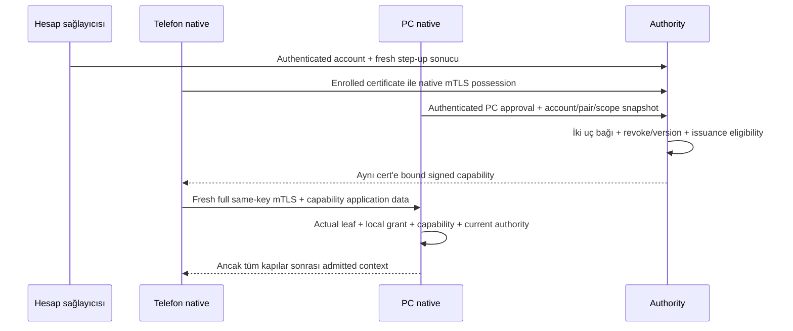

# Kloda — Capability ve admission profili

**Statü:** [ADR 0004](../decisions/0004-certificate-bound-capability-and-authority-responsibilities.md) yönleri kabul edildi; ES256 **provisional**, platform/TLS/device-key **production gate** açık. Ürün protokol/API implementasyonu veya doğrulanmış production profile değil. [ADR 0007](../decisions/0007-matrix-verification-and-device-continuity.md) verification/device sürekliliği sınırıdır. Private claim/type/wire/DB şeması, KMS/hosting ve runtime trust/time/fence uygulaması hâlâ açık.

## Sonuç ve kanıt sınıfları

Kabul edilen yön: **JWS/JWT certificate-bound capability + her file session'da fresh full aynı-device-key TLS1.3**; server ES256 signer yönü runtime **ve** KMS feasibility gelene kadar provisional. Telefon leaf DER thumbprint'i token'a, actual leaf SPKI'si ayrı olarak yerel SAS snapshot'ına bağlanır. Account login, Matrix trust graph, TLS/probe veya geçerli token tek başına file authority açmaz.

- **accepted-policy:** ADR0003/0004/0007; mevcut aynı-scope LAN için `<24h`, local revoke/öğrenilmiş deny ve durable publication fence.
- **observed-evidence:** patched-SDK native deneyinde host8, TLS25+25, verification26+26. [Native kanıt kaydı](poc-native-verification-evidence.md); bu dokümantasyon aktarımında suite yeniden çalıştırılmadı.
- **Tarihsel public inspection:** Node v22.23.1 iki historical happy-path public cert/key/TLS kaydı, exit0;88 assertion shape kontrollerini de içerir,88 authority testi değildir. [Exact evidence](evidence/certificate-binding-inspection.json), [exact stdout](evidence/certificate-binding-stdout.json), [kaynak/limit özeti](evidence/capability-research-summary.json). Inspector kaldırılmıştır; bu aktarımda yeni crypto smoke yok.
- **unverified / production gate:** issuance/admission, native peer-DER/session bağı, gerçek enrollment/approval provenance, trusted time, scope/commit, issuer custody. JWT signing/verifying, revoke ve file enforcement runtime'ı yürütülmedi. Aşağıdaki semantik/enforcement tabloları hedef sözleşmedir, implemented API değildir.

Eski sözleşmedeki UTF-8-only signer blocker **yerel SDK yamasıyla feasibility açısından superseded**; upstream destek, SDK production adoption ve aynı key ile authority-server enrollment kanıtlanmış değildir. Ürün API `AppModule` boş; incelenen API manifesti JOSE içermez. Desktop/mobile WebDAV credentials ve journal ayrı backup hattıdır; PC peer grant/fence implementasyonu sayılmaz.

## 1. Trusted provenance tablosu

| Mantıksal girdi | Üretici / doğrulayıcı | Güvenilir karşılaştırma ve failure | Sınıf / kalan kanıt |
|---|---|---|---|
| Kloda account↔Matrix user/device | Hesap authority'si ve native uç kayıtları; merkez+PC | Authenticated enrollment/mapping; client subject/name/string eşitliği yeterli değil | Proposal; sabit synthetic PoC user gerçek account mapping kanıtı değil |
| PC ve telefon identity / roller | Native cihaz key'i ve ayrı account registration; karşı uç | Yerel enrolled device/role kaydı + SAS snapshot; IP/hostname/display name kimlik değildir | SAS/TLS alt-gate observed; gerçek registration unverified |
| Immutable peer key | Bilateral SAS Done, local confirmations, MAC-v2; native uç | Aktif expected user/device/flow ve Done verified-device key; discovery/cross-signing/caller key pin yaratmaz | Patched native PoC observed; production grant'e geçiş unverified |
| Installation continuity | OS-protected key + backup dışı epoch/authorization; PC admission | Missing epoch/restore şüphesi → online PC onayı+SAS+yeni grant; key mevcut olsa da offline ret | Accepted policy; fiziksel restore/rollback detection unverified |
| PC scope/operations onayı | PC yerel kullanıcı/enforcement; merkez ve PC | Belirli peer/PC/alan/işlem onayı, yerel kayıtla intersection; UI path token'a güven aktarmaz | Policy/proposal; filesystem race çözümü yok |
| Pair/grant security version | Merkezi karar ve PC durable deny/version state; PC | Yerel fence/version mismatch stale allow'dan önce; yeni key/scope kayıt devralamaz | Policy; transaction/durable implementation unverified |
| Issuer trust | Authenticated, token'dan bağımsız issuer/key configuration; PC | `kid` yalnız mevcut key lookup; token `jku/jwk/x5u` trust kuramaz | Proposal; custody/distribution/rotation unverified |

Merkez yalnız hesap/cihaz/pair ve opaque scope/operation control metadata'sı tutabilir. PC gerçek filesystem root eşlemesini yerelde tutar; filepath/katalog, fotoğraf hash listesi veya dosya byte'ı merkezi indeks yapılmaz. Supabase Auth+Postgres belgede seçilmiş ürün yönüdür, çalışan entegrasyon değildir.

## 2. Capability semantiği tablosu

Aşağıdaki standart alanlar önerilen profile zorunlu anlamlardır; private claim isimleri, `typ` literal'i, JSON/wire/DB/endpoint şeması **bu paket tarafından seçilmez**. Bu somut serileştirme kapısı sonraki izole profile çalışmasında kapatılmalıdır. [RFC7519 §4.1](https://www.rfc-editor.org/rfc/rfc7519#section-4.1), [RFC7515 §§4–5](https://www.rfc-editor.org/rfc/rfc7515#section-4), [RFC8725 §§3.8–3.12](https://www.rfc-editor.org/rfc/rfc8725#section-3.8).

| Alan / anlam | Üretici → doğrulayıcı | Trusted karşılaştırma / ret |
|---|---|---|
| `iss` authority issuer | Merkez signer → PC, telefon | Bağımsız issuer allowlist/key ownership; başka issuer veya bilinmeyen trust ret |
| `sub` Kloda hesap bağı — profil tercihi | Merkez authenticated account → iki uç | Yerel grant/enrollment account ile eşit; yalnız token/string veya Matrix user benzerliği yeterli değil |
| `aud` hedef PC — profil tercihi | Merkez grant → hedef PC, telefon | Tam beklenen PC audience; başka PC/context ret |
| `iat` issuance zamanı | Merkez → PC | Zaman tutarlılığı; offline t0 **değil**, yeni pencere yaratmaz |
| `nbf` kullanım alt sınırı | Merkez → PC | Güvenilir time interval henüz nbf'yi kapsıyorsa ret/online bekle; library default'u yeterli değil |
| `exp` mutlak üst sınır | Merkez → PC | Güvenilir current-time üst sınırı `>=exp` ise ret; uncertainty süresini uzatmaz. `<24h` elapsed ayrıca kontrol edilir |
| `jti` capability identity | Merkez → PC cache/deny/version ilişkilendirmesi | JWT identifier handshake nonce'u değil. Aynı değişmemiş geçerli capability fresh TLS'te tekrar kullanılabilir; window yenilenmez |
| `cnf.x5t#S256` telefon leaf cert bağı | Gerçek enrollment TLS cert'inden authority → PC | Unpadded base64url SHA256 **full leaf DER**; gerçek session leaf'iyle eşit. SPKI/raw-key/root hash'i veya request header cert'i ret |
| Protected header `alg` | Signer → fixed verifier policy | Önerilen `ES256` tek allowlist; `none`, `EdDSA/Ed25519` aliasing ve key-family confusion ret |
| Protected header `kid` | Trusted issuer key identifier → key lookup | Yalnız enrolled issuer/key kümesinde lookup; unknown/revoked kid offline ret; token key öğrenme yok |
| Protected header `typ` | Ayrı capability token sınıfı → iki uç | Onaylanacak sabit type ve mutually-exclusive rules; login JWT/type metadata file authority değildir |
| Pair + iki device + roller | Authenticated merkez pair kaydı → yerel grant | Account/PC/phone/role eşleşir; caller alanıyla mapping değişmez |
| Scope + operations | PC exact onayıyla merkez → PC enforcement | Yerel grant ile intersection; yeni alan/işlem online PC onayı ister |
| Install epoch + security/grant version | Enrolled continuity/central state → PC local durable kayıt | Epoch/identity tutarsızlığı, öğrenilmiş revoke/version mismatch ret; stale token fence'i geri alamaz |

`cnf` possession semantiği [RFC7800 §3](https://www.rfc-editor.org/rfc/rfc7800#section-3); Kloda grant/time/fence semantiğini RFC sağlamaz. `cnf.x5t#S256` yalnız client cert'e bağlanır; PC anahtar/pair bağı yerel trusted kayıt ve capability context'iyle ayrıca denetlenir.

## 3. Session admission tablosu

| Kapı | Girdi ve karşılaştırma | Ret / yetki sınırı |
|---|---|---|
| Fresh full TLS1.3 | İki native uç CertificateVerify/Finished; PSK resumption/0-RTT yok | Eski proof/socket/session veya yalnız cipher negotiated yetki açmaz |
| Gerçek telefon leaf'i | PC TLS endpoint'inden actual peer DER; `cnf.x5t#S256` hash equality | Token taşıyan kişinin bound cert'i farklıysa ret |
| SAS key equality | Gerçek leaf SPKI raw Ed25519 key = immutable peer snapshot | Sadece trusted root pin yeterli değil: delegated farklı leaf/CV key ret |
| PC kimliği | Telefon native TLS gerçek PC leaf key'i = beklenen local PC snapshot | Signaling server name/IP veya token audience tek başına peer auth değil |
| Yerel grant+context | Account/pair/PC/phone/roles/scope/operations/epoch/version | Matrix verified, TLS Done veya doğru JWT tek başına admission değil |
| Current authority ve validity | Trusted issuer/key/type/signature/claims + online karar veya dar LAN cache | Local deny/version/expiry önceliği; token kendini doğrulayamaz |
| Session sabitliği | Kabul edilen grant/capability context aynı TLS bağlantısında sabit | Değişen capability/grant yeni admission; file operation ancak tüm kapılar sonrası |

Token TLS application data içinde değerlendirilir; capability **TLS transcript'inde imzalı değildir**. Aynı valid token ile reconnect, fresh TLS proof ve güncel local authority gerektirir; capability copy alone bearer erişim değildir. [RFC8446 §§4.4.2–4.4.4](https://www.rfc-editor.org/rfc/rfc8446#section-4.4.2), [RFC8705 §3](https://www.rfc-editor.org/rfc/rfc8705#section-3).

Public örnek: Android cert DER thumbprint `GKhM4FfQwF2NljPgu1TzArlQy2PBuBuIEG_86DZhDDs`; aynı cert SPKI hash'i `4TJDZM0_feghbimWS7AgZBmvbQE6QSecR4t7HDKmyfs`. Node incelemesi bu ayrımı gösterdi; bir token bu çalışmada üretilmedi.

## 4. Issuance / enrollment güven tablosu

| Authority'nin öğrenmesi gereken | Güvenilir kaynak önerisi | Açık implementation kapısı |
|---|---|---|
| Account ve fresh riskli işlem onayı | Hesap sağlayıcısından authenticated account/session/step-up | Supabase doğrulaması/recency/policy çalışan entegrasyon değil |
| Telefon cert possession | Authority token/enrollment native mTLS endpoint'inde gerçek aynı cert/key | Mevcut native config sadece PC-peer fixture; authority endpoint enrollment/hostname/trust uyumu kanıtlanmadı |
| PC identity ve gerçek local scope onayı | Enrolled PC'nin authenticated kontrol kanalında kendi native key'i ve PC onay kaydı | PC enrollment/account-key provenance ve authenticated approval correlation eksik |
| Bilateral SAS / pair bağı | İki uç native completed snapshot'ını ilgili account/PC/phone görüşmesiyle ilişkilendiren authority değerlendirmesi | Caller “SAS done”/UI bool tek başına evidence değil; report provenance ve grant acceptance feasibility eksik |
| Issuance anındaki eligibility | Merkezi hesap/session/device/pair deny/version ve PC scope onayı birlikte | Atomic karar/version/correlation ve reissue yolu unverified |

Diyagram hedef trusted-data provenance sırasıdır; endpoint, wire API veya başarılı runtime flow değildir. Certificate possession, account authorization ve PC onayı ayrı koşullar. OAuth mTLS client authentication ile certificate-bound token mekanizması complementary fakat ayrı; tam OAuth server uygulanmış sayılmaz. [RFC8705 §§1–3](https://www.rfc-editor.org/rfc/rfc8705#section-1).

Authority ingress TLS terminate eden proxy kullanacaksa header'dan peer cert kabul edilmez; trusted/protected proxy→application metadata bağı ayrıca kanıtlanmalı. [RFC8705 §6.5](https://www.rfc-editor.org/rfc/rfc8705#section-6.5) bunu tanımlar ama güvenli metadata taşıma mekanizmasını **seçmez**. PC↔telefon file E2EE backend/proxy'de terminate edilemez. Custom CSR/challenge signature protocol yok.

## 5. Certificate lifecycle tablosu

| Olay | Grant/key davranışı | Capability / offline davranışı |
|---|---|---|
| Aynı key ve kesin aynı DER ile fresh reconnect | Yerel grant ancak current version/scope/continuity ile kalır | Geçerli capability yeniden kullanılabilir; full TLS gerekir, t0 yenilenmez |
| Aynı key, yeni DER/renewal | SAS identity key'i otomatik değişmiş sayılmaz | Eski cert-bound token ret; authenticated online reissue gerekir, scope genişleyemez |
| Process restart | Normal restart epoch'u keyfi değiştirmez | Engine cert cache persistent garanti değil; cert ve trusted elapsed continuity kanıtı yoksa online bekle |
| Epoch kaybı/restore şüphesi veya retained epoch+SDK DB kaybı | Eski key varlığı grant'i diriltmez | Online PC onayı+SAS+yeni grant; key/DB/authorization sessiz reset yok |
| Provider geçici locked/unavailable | Key loss/reinstall sayılmaz | Ret/bekle, mevcut key/ciphertext/journal korunur; fallback veya yeni identity yok |
| Gerçek key loss / başka leaf key | Yeni device identity eski grant'i devralamaz | Re-pair; eski token key'e taşınmaz; PC final korunur |
| Cert expiry veya token validity kanıtı yok | Yerel durable history korunur | Yeni admission/operation/publication ret/online bekle; expiry reissue yerine offline grace yok |

Engine lifetime certificate cache production cert storage/renewal tasarımı değildir. Same-key/new-DER token reddi mantıksal öneridir; public donor smoke'u bunu runtime test etmedi. DER-bound token/key-bound grant ayrımı [RFC8705 §3.1](https://www.rfc-editor.org/rfc/rfc8705#section-3.1) ve ADR continuity politikasına dayanır.

## 6. Sürümlü imza uyumluluk tablosu

| JWS `alg` | TypeScript issuer adayı `jose 6.2.12` | Rust native verifier adayı `jsonwebtoken 10.1.0` | Bu paketin önerisi |
|---|---|---|---|
| `Ed25519` | Tagged types ve gerçek dispatch'te Ed25519/OKP kabulü | Enum/parser'da **yok**, `InvalidAlgorithmName` | İki aday arasında exact identifier uyumsuz; seçilmedi |
| `EdDSA` — karşılaştırma, aday yerine geçmez | Ed25519 backend ile destek | Ed25519 verifier ile destek | [RFC9864 §2.2](https://www.rfc-editor.org/rfc/rfc9864#section-2.2) polymorphic/deprecated identifier; fully-specified Ed25519 diye yeniden etiketlenmez |
| `ES256` | Dispatch `ECDSA`, P-256, SHA-256; CryptoKey/KeyObject/JWK public formatları | Enum/parser ve P-256 verifier; JWK x/y→SEC1 point, EC PEM (`use_pem`) | **İncelenen iki aday için ES256 önerisi; signatureProfileReady=true yalnız kaynak düzeyinde** |

Algoritma backend signer'a aittir; telefon/PC possession key'i Ed25519 kalır. Server ES256 key'i ikinci endpoint identity key değildir. Üçüncü library, legacy downgrade veya manual JOSE eklenmedi. JWT cross-runtime sign/verify, ECDSA raw r||s encoding/import, feature/backend ve gerçek KMS desteği sonraki feasibility kapısıdır.

Public import ayrıntısı: [Rust decoding source](https://raw.githubusercontent.com/Keats/jsonwebtoken/v10.1.0/src/decoding.rs) JWK x/y'yi uncompressed SEC1 `0x04||x||y` yapar; RustCrypto verifier `from_sec1_bytes` kullanır. `from_ec_der` yalnız bytes'ı geçirir, ASN.1 SPKI DER parser garantisi değildir. Profile kty=EC/crv=P-256 ve key ownership'i ayrıca kısıtlamalı; `from_jwk` tek başına curve/issuer/profile policy sağlamaz. SPKI PEM/JWK→verifier import'u ve raw r||s interoperability hâlâ runtime gate'tir; KMS DER signature raw JWS signature sanılmaz.

Doğrulama gereksinimi: `jose` explicit `algorithms:['ES256']`, trusted key resolver ve issuer/audience/subject/type/required-claim policy; Rust `Validation::new(Algorithm::ES256)` tek allowlist, required iss/sub/aud/nbf/exp ve domain alanlarının ayrıca validation'ı. `iat/jti/cnf` zorunluluğunu Rust required-spec helper'ına yazmak yetmez: helper yalnız exp/nbf/aud/iss/sub alanlarını işler. `typ` için Rust built-in Validation desteği gözlenmedi; protected header profile check ayrı gereklilik.

**Somut zaman engeli:** Rust kaynak default'u `leeway=60`, `validate_nbf=false`; `exp < now` karşılaştırması ve `SystemTime` saniye saati kullanıyor. Sadece leeway=0 bile `now==exp` için strict-ret veya trusted elapsed garantisi sağlamaz. Öneri library defaults'a dayanmaz: bağımsız conservative validity gate `nowUpper>=exp` veya `nowLower<nbf` olduğunda ret; `<24h` trusted elapsed gate ayrıca. Saat/bound uygulaması ve eşitlik testleri unverified. SignatureProfileReady, authorization/timeProfileReady değildir.

Kaynaklar: [jose tagged manifest](https://raw.githubusercontent.com/panva/jose/v6.2.12/package.json), [types](https://raw.githubusercontent.com/panva/jose/v6.2.12/src/types.d.ts), [actual alg dispatch](https://raw.githubusercontent.com/panva/jose/v6.2.12/src/lib/jws_algorithms.ts), [allowlist/signature failure](https://raw.githubusercontent.com/panva/jose/v6.2.12/src/lib/jws_verify.ts), [key requirements](https://github.com/panva/jose/issues/210#jws-alg); [Rust manifest](https://raw.githubusercontent.com/Keats/jsonwebtoken/v10.1.0/Cargo.toml), [alg enum/parser](https://raw.githubusercontent.com/Keats/jsonwebtoken/v10.1.0/src/algorithms.rs), [P-256 verifier](https://raw.githubusercontent.com/Keats/jsonwebtoken/v10.1.0/src/crypto/rust_crypto/ecdsa.rs), [validation](https://raw.githubusercontent.com/Keats/jsonwebtoken/v10.1.0/src/validation.rs), [DecodingKey docs](https://docs.rs/jsonwebtoken/10.1.0/jsonwebtoken/struct.DecodingKey.html).

## 7. Issuer custody / rotation tablosu

| Konu | Önerilen sınır / failure | Henüz seçilmemiş / kanıtlanmamış |
|---|---|---|
| Server private signer | Yalnız authority custody; uç private key'inden ayrı, uçlara dağıtılmaz | Hosting/KMS/provider, ES256 API ve signature encoding |
| Trust bootstrap | Trusted issuer→key configuration, authenticated dağıtım | Initial trust ve refresh güven zinciri; token `jku/jwk/x5u` kurulumu yok |
| Unknown kid / key fetch | Unknown offline ret; online yalnız bağımsız trusted issuer yolu | JWKS cache/fetch issuer trust sağlamaz; URL caller/header'dan alınmaz |
| Rotation overlap | Açık trusted validity; mevcut token/time/version/fence sınırları değişmez | Overlap süre/operasyonel rollout seçilmedi; offline pencere uzatılmaz |
| Öğrenilmiş signer compromise/revoke | Eski token'ın cryptographic validity'si ret/fence'i aşamaz | Durable dağıtım/enforcement ve issuance cutoff |
| Offline öğrenilmemiş compromise/central revoke | Anında tespit vaadi yok; kalan dar LAN pencere riski görünür | Her signer compromise'ını offline algılama garantisi yok |
| Hata/audit/privacy | Secret/medya key/file içeriği log/backend'e gitmez; fail closed | Custody audit/availability/operational recovery kanıtı yok |

## Authority sorumluluğu ve kalıcı state sözleşmesi

[ADR 0004](../decisions/0004-certificate-bound-capability-and-authority-responsibilities.md) merkezi karar/signing/revoke için **NestJS application use-case'leri**, yerel scope/admission/file/fence için **PC enforcement** ayrımını kabul eder. Interface→application→domain; infrastructure domain port'larını uygular; dosya başına tek use-case. Mobile/desktop FSD değişmez. Hosting, custody ve gerçek entegrasyon bu rol kararıyla doğrulanmış olmaz.

| İş | Actor | Trusted input | Karar | Kalıcı kayıt sınırı | Failure |
|---|---|---|---|---|---|
| Pair acceptance | Authority + iki native uç + PC kullanıcı | Account/step-up, enrolled keys, bilateral SAS, exact PC scope | Tek taraf onayı veya Matrix trust yeterli değil | Merkez control pair/grant; PC local approval/key/epoch | Cancel/timeout/mismatch → grant yok |
| Issuance/reissue | Authority | Authenticated enrollment actual cert; account/pair/PC approval; current version | Cert-bound capability, yalnız mevcut eligible scope | Control issuance/revoke ilişkisi; signer custody | Input provenance/possession eksik → issuance yok |
| Local revoke | PC | Local yetkili revoke olayı | Aktif grant/operation/publication fence | PC durable deny/version; final/journal korunur | Eski token veya late allow fence'i silemez |
| Central revoke/version | Authority, öğrenince PC | Authenticated central decision + correlated context/version | Öğrenilen deny aktif erişimi keser | Merkez revocation; PC durable known deny | Offline öğrenilmemiş olay için instant-revoke garantisi yok |
| Trust refresh | PC + authority | Token dışı configured issuer, authenticated request/response | Trust ve authority freshness ayrı; t0 request-start | PC trusted key state + correlated freshness/deny | Unknown kid/ordering/time belirsizliği → ret/bekle |
| Admission/reconnect | PC ve telefon native | Actual TLS leaves, immutable SAS, local grant, verified capability, time/eligibility | Sabit admitted context; her bağlantıda fresh possession | PC authorization state; session geçici, cache grant değildir | Herhangi gate eksik → file ops yok |
| Status/list/download/upload | PC | Current admitted context + approved root/operation + current fence/time | Her operation/stream içinde authorization sürer | Local staging/journal; backend byte/catalog yok | Deny/expiry → erişim kesilir; completed/final yaratılmaz |
| Commit/publication | PC | Scope-safe staging + current authority + aynı linearization order | Yalnız fence öncesi gerçekten durable commit | Normal PC final ve truthful journal completion | Staging/journal varlığı commit authority'si değildir |
| Startup/resume/reconcile | PC + fresh authenticated peer | Current same-scope admission, actual disk/journal durum | Reconcile authority kapısını atlamaz | Önceki geçerli final korunur; pending staging korunur | Journal'dan session/completed/izin türetilmez |

Yeni cihaz/ilk pair/scope artışı/recovery riskli işleminde online fresh step-up ve PC onayı; normal sync'te per-run TOTP veya biometric/userPresence yok. Software OS protection hardware-backed garantisi değildir. PC final normal dosyadır, DRM/şifreli vault tasarımına çevrilmez. WebDAV direct/HTTP(S) relay ve SMB LAN-only kararları değişmedi; bu peer profile relay hosting/teknolojisi seçmez.

## Offline öncelik ve publication fence

Sıra:

1. Local revoke, öğrenilmiş authenticated deny/compromise veya version mismatch → durable ret/fence; offline cache fallback yok.
2. İlk pair, yeni device/scope, recovery veya remote erişim → online; LAN istisnasına girmez.
3. Yalnız önceden verified/enrolled aynı-scope LAN, center **unreachable** (explicit denial değil), geçerli capability, retained continuity ve trusted elapsed üst sınırı `<24h` ise dar cache kullanılabilir.
4. LAN classification, token validity veya elapsed bound kanıtlanamıyorsa online bekle. Reachable fakat unauthenticated/bozuk reply trusted success/deny değildir; mevcut policy'nin unreachable ve bound koşulları kanıtlanmadan allowance üretmez.

`t0`: en son başarıyla authenticated/correlated merkez kontrolünün **request-start** anı. Elapsed response receipt'e değil bu başlangıca bağlanır. Başarılı yeni merkezi kontrol ayrı t0 verebilir; reconnect, capability iat/reissue/copy, wall-clock ayarı veya restart kendi başına veremez. Geç response mevcut request'in kalan ömrünü uzatmaz. Response gelene kadar başlatılmış istek authority değildir; arada öğrenilen deny/version fence stale success'ten önceliklidir.

Etkili izin hem trusted elapsed upper `<24h`, hem token validity, hem current local grant/version/deny koşullarının intersection'ıdır. Token önce biterse erişim önce kesilir. Token wall-clock koşulu ve elapsed bound ayrı problemlerdir; ikisi güvenilir olmalı. Suspend/OS/process restart süreyi sıfırlamaz; continuity yoksa online bekle. Native clock/persisted secure time çözümü ve release OS compatibility kanıtı seçilmiş/kanıtlanmış değildir; iOS16.4+/Android7+ destek hedefi [ADR 0001](../decisions/0001-mobile-sync-behavior-and-framework-constraints.md) ile ayrı tutulur.

PC'de revoke/expiry kararı ve commit/publication **tek authorization/publication linearization order** içinde:

- Fence önce linearize olduysa yeni final/publication/completed yok; aktif status/list/download/upload durur. Sadece admission'da kontrol veya check-then-rename yeterli değil.
- Geçerli commit önce gerçekten durably linearize olduysa final korunur; sonra gelen revoke o dosyayı silmez. Kaydedilen pending/completed bool durable disk commit yerine geçmez.
- Staging, ciphertext, journal ve önceki final korunur; sonraki reconcile aynı-scope **yeni current authenticated authority** ile yapılır. Yeni fence'i journal/late allow/backfill silemez.
- Path normalization, symlink/mount/file-open ve rename/durability yarışı aynı scope/fence güven sınırında çözülmeli; atomik filesystem/transaction tasarımı bu araştırmada uygulanmadı veya doğrulanmadı.

Politika ADR0003/0004/0007; tarihsel source-map ve hash'ler [research summary](evidence/capability-research-summary.json) içinde saklıdır. Bunlar current repo hash'i veya runtime grant garantisi değildir.

## Onaylanan yönler ve açık gate'ler

| Karar | Bugünkü statü / dayanak | Açtığı / açmadığı kapsam |
|---|---|---|
| Certificate-bound admission | Kabul edildi; RFC8705 + historical native/public alt-gate | Feasibility planı hazırlanabilir; platform/TLS/device-key production gate'i açık |
| ES256 server signer | **Provisional**; iki aday sürümde shared exact identifier | Runtime ve gerçek KMS feasibility gerekir; source-only support final/adoption değil |
| Nest–PC sorumluluğu | Kabul edildi; central control + PC local enforcement | Rol seçimi; hosting/custody/enrollment veya ürün servisi tamamlandı değil |
| Certificate lifecycle | Kabul edildi; key-bound grant / exact-DER-bound token | Same-key/new-DER online reissue; restart/offline süreklilik garantisi yok |

**Sonraki gate:** [izole issuance/admission feasibility planı](../implementation/issuance-admission-feasibility-plan.md) hazır, execution ayrı onay bekliyor; kendiliğinden kodlama yok. Gerçek account↔device mapping, authority native mTLS, authenticated PC approval, exact serialization/type, issuer custody/trust/rotation, runtime/KMS signatures, strict trusted time, scope-safe durable fence ve fiziksel/real-network/SDK sustainability gate'leri açık.

## Kaynak erişimi ve çalışma sınırı

Tarihsel araştırmada resmi source/RFC reader kullanıldı; cache/install gerektirebilecek Context7 npx çalıştırılmadı. Node crypto docs observed v22.23.3: [X509Certificate](https://nodejs.org/docs/latest-v22.x/api/crypto.html#class-x509certificate), [KeyObject.export](https://nodejs.org/docs/latest-v22.x/api/crypto.html#keyobjectexportoptions); actual inspection runtime v22.23.1. Kaynak uyumluluğu JWT/KMS runtime değildir; bu kalıcılaştırma yalnız docs/public evidence değişikliğidir.

## Ayrı review geçişi — tamamlandı

Yazımdan sonra iki bağımsız read-only geçiş yapıldı: `CapabilityProfileReview` RFC/tagged-source/kanıt sınırlarını; `AcceptancePolicyReview` kabul edilmiş politika, önceki32 hedef ve yeni36 hedefi değerlendirdi. Actionable finding yok. Bu **belge tutarlılığı** sonucudur; runtime/security certification değildir.

Public inspection native local identity cert DER'ini recorded opposite-peer/SAS key'leriyle karşılaştırır; **actual peer DER export + admitted-session association** runtime kanıtı değildir. Historical review document consistency içindir, security certification değil. [Production gate kaydı](production-gates.md) ve [session coverage index](../implementation/session-documentation-index.md) güncel sınırları ayırır.

## Tarihsel alternatifler ve superseded blocker

Native TLS öncesi DPoP/HTTP ([RFC9449](https://www.rfc-editor.org/rfc/rfc9449#section-4)) method/URI/token-hash possession sağlasa da karşılıklı PC authentication/session-channel binding'i tek başına sağlamaz; standart exporter ([RFC9266](https://www.rfc-editor.org/rfc/rfc9266#section-4.1)) kimlik/grant değildir, üst-profile/native support ayrıca gerekir. WebRTC DTLS fingerprint Matrix device key'e kendiliğinden bağlı değildir ([RFC8827](https://www.rfc-editor.org/rfc/rfc8827#section-4.3)). COSE encoding alternatifi araştırıldı, seçilmedi. Bu seçenekler ikinci key/custom SAS/exporter+nonce handshake onayı değildir.

Matrix0.19.1 UTF-8-only `OlmMachine::sign(&str)` binary TLS transcript input'unu doğrudan imzalayamaz; base64 string imzalamak TLS signature değildir. İki-method byte-sign patch native feasibility blocker'ını kapattı; **upstream API/intended-use, SDK sustainability ve production adoption gate'i kapatmadı**. Diagnostic imza girdisi `kloda-native-verification-poc/v1` prefix'i + LF + nonce'dur; account/PC/role/scope/capability/channel bağını taşımaz, production admission proof değildir.
